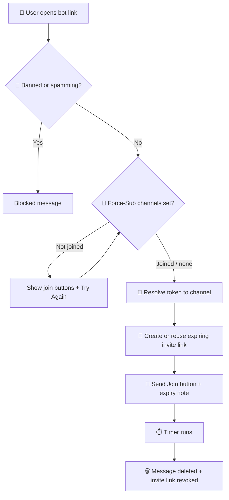

<div align="center">

# 🔐 PRO UI LINK STORE

### Protected Telegram Channel Link Sharing Bot — with a Full Button-Based Admin Panel

*Expiring invite links · Force-Subscribe · Auto-Approve · Broadcast · Live Stats · Multi-Layer Backup*

<br>


</div>

---

## 📑 Table of Contents

- [✨ Overview](#-overview)
- [🚀 Feature Highlights](#-feature-highlights)
- [🧠 How It Works](#-how-it-works)
- [🎛️ Admin Panel Guide](#️-admin-panel-guide)
- [📦 Installation & Deployment](#-installation--deployment)
- [⚙️ Configuration (Environment Variables)](#️-configuration-environment-variables)
- [💾 Data Safety & Backups](#-data-safety--backups)
- [⚡ Performance & Protection](#-performance--protection)
- [📂 Project Structure](#-project-structure)
- [🛠️ Troubleshooting](#️-troubleshooting)
- [❓ FAQ](#-faq)
- [👑 Credits](#-credits)

---

## ✨ Overview

**PRO UI LINK STORE** is a high-performance Telegram bot that turns your private and public channels into **protected, trackable, self-expiring join links**.

Instead of sharing a permanent invite link that anyone can copy and leak, you share a **bot deep link**. When a user opens it, the bot generates a **fresh invite link that expires automatically**, shows it once, and then deletes the message. Everything — from adding channels to broadcasting — is controlled through **one clean, button-only admin panel**. No commands to remember.

> 💡 **Zero commands.** Send `/start` and tap **Admin Panel**. That is the only command in the entire bot.

**Built for:**

- Channel owners who want to stop link leaks and invite-link abuse
- Networks managing dozens of channels from a single bot
- Admins who want force-subscribe, auto-approve and analytics in one place

---

## 🚀 Feature Highlights

### 🔗 Smart Link Engine
| Feature | Description |
|---|---|
| **Normal Links** | Direct-join deep links for any channel the bot administers |
| **Request Links** | Join-request (approval) links for private channels |
| **Self-Expiring Invites** | Every delivered invite link expires automatically (default **5 minutes**) |
| **Auto-Delete Messages** | The link message disappears from the user's chat when the link expires |
| **Auto-Revoke** | Expired invite links are revoked on Telegram, keeping your invite list clean |
| **Per-Channel Expiry** | Override the global expiry for individual channels (1m – 1h) |
| **Bulk Links** | Generate links for many channels in one go |
| **Genlink** | Convert **any URL** into a protected, click-tracked bot link |
| **Text Link Export** | All channel links as copy-friendly text, paginated |
| **Click Analytics** | Per-link clicks: today, last 7 days, all-time |

### 📢 Force-Subscribe
- Make users join **one or more channels** before they can open a link
- Two modes **per channel**: 🟢 **Request mode** or 🔴 **Direct join mode** — switch with one tap
- Friendly "♻️ Try Again" verification flow
- Join requests are tracked instantly, so request-mode verification is immediate

### ✅ Auto-Approve Join Requests
- Automatically approves join requests after a configurable delay (**0 – 3600 seconds**)
- Quick presets: `0s · 5s · 10s · 30s · 60s` or a custom value
- **Per-channel ON/OFF** toggle
- Optional **welcome DM** with a join button and your branding
- Optional channel whitelist through the `CHAT_ID` variable
- Approvals run through a background scheduler, so the bot stays fast even with huge request volumes

### 📣 Broadcast System
- Send any message to all active users from inside the bot
- 📌 **Pin**, 🔕 **Silent**, and 🗑️ **Auto-delete** (`none · 30s · 1m · 5m · 1h · 24h`) options
- 👁️ **Preview** before sending
- Live **progress bar** with sent / blocked / failed counters
- 🛑 Stop at any time — and **resume after a restart** if a broadcast was interrupted

### 📊 Analytics & Monitoring
- **Live Stats:** uptime, total / active / inactive users, new users (today & 7d), link clicks, approvals, join requests, genlinks, admins, bans
- **🏆 Top 5 Links** by clicks
- **Health Dashboard:** ping, RAM usage, uptime, local DB size, backup status, pending jobs, running tasks, Python version
- **🗞️ Daily Summary** delivered to the owner every night at **9 PM IST** (can be turned off)

### 👑 Administration
- Multiple **admins** (add / remove — owner only)
- **Ban / Unban** users by numeric ID or by forwarding their message
- **Dynamic Branding:** a custom "Powered by" footer on every bot message
- **Channel Buttons:** up to **60** custom buttons on the public *Channels* screen
- 🧹 **Cleanup:** detect and mark users who blocked the bot (owner only)

### 💾 Bulletproof Data Storage
- **SQLite** for fast local operations
- **Private Telegram channel backups** — up to **5 channels**, each holding a full copy
- **MongoDB store** — spreads data across **multiple clusters** automatically
- Automatic **restore on startup**, plus a final backup on shutdown

---

## 🧠 How It Works



**In plain words:**

1. You add your channel to the bot (bot must be an admin).
2. The bot creates a **signed deep link** for that channel. Tokens are derived with SHA-256 and a secret salt, so they cannot be guessed.
3. You share that bot link anywhere.
4. When a user opens it, the bot checks bans, spam limits and force-subscribe status.
5. The bot hands out a **temporary invite link** and schedules its deletion and revocation.
6. If *Auto-Approve* is on, join requests are approved automatically after your chosen delay.

---

## 🎛️ Admin Panel Guide

Send `/start` to the bot → tap **👑 Admin Panel**.

```
👑 ADMIN PANEL
├── 📺 Channels        → add / remove channels, view links, clicks, expiry
├── 🔗 Links           → normal, request, text, IDs, bulk, genlink, genlink list
├── 📢 Force-Sub       → add channels, toggle Request / Direct mode
├── ✅ Approve         → auto-approve ON/OFF, delay, per-channel control
├── 📣 Broadcast       → compose, preview, send to all users
├── 📊 Stats           → live statistics and top links
├── 👑 Admins          → add / remove admins (owner only)
├── 🏷️ Brand           → "Powered by" footer
├── 🚫 Ban             → ban / unban users
├── ⚙️ Settings        → global link expiry, welcome DM, daily summary
├── 💾 Backup          → backup now, download copy, restore, Mongo (owner only)
├── ❤️ Health          → ping, RAM, uptime, jobs
├── 🔘 CH Buttons      → custom buttons on the public Channels screen
└── 📖 Help            → in-bot usage guide
```

### 1️⃣ Add a Channel
1. Add the bot to your channel as **Admin** with the **Invite Users via Link** right.
2. Open **Admin Panel → Channels → ➕ Add Channel**.
3. Do **one** of the following:
   - Forward any post from the channel to the bot
   - Send the channel ID (`-100xxxxxxxxxx`)
   - Send the channel `@username`
4. The channel page shows your **Normal** and **Request** links, click stats, expiry, approval and force-sub status.

### 2️⃣ Get Your Links
Open **Admin Panel → 🔗 Links**:

| Button | What you get |
|---|---|
| 🔗 **Normal** | Tap-to-open buttons for direct-join links |
| 🔔 **Request** | Tap-to-open buttons for join-request links |
| 📋 **Text Links** | Every channel's links as copyable text |
| 🆔 **IDs** | All connected channels with their IDs |
| 📦 **Bulk** | Paste many channel IDs (space or new-line separated) and get all links |
| 🔐 **Genlink** | Send any URL and receive a protected bot link |
| 🗂️ **Genlink List** | See all genlinks with click counts, and delete any of them |

### 3️⃣ Set Up Force-Subscribe
1. **Admin Panel → 📢 Force-Sub**
2. Choose **➕ Add (Direct)** or **🔔 Add (Request)**.
3. Forward a post or send the channel ID / `@username` (bot must be admin there).
4. Tap a channel in the list any time to flip between 🟢 **REQ** and 🔴 **DIRECT**.
5. Tap 🗑️ to remove a channel, or **Remove All** to clear the list.

### 4️⃣ Turn On Auto-Approve
1. **Admin Panel → ✅ Approve**
2. Toggle **Auto Approve: ON**.
3. Pick a delay: `0s`, `5s`, `10s`, `30s`, `60s` — or tap **✏️ Custom Time** for any value from 0 to 3600 seconds.
4. Use **📺 Per Channel** to switch approval off for specific channels.
5. Control the welcome message from **Settings → 💌 Welcome DM**.

### 5️⃣ Send a Broadcast
1. **Admin Panel → 📣 Broadcast → New Broadcast**
2. Send the message you want to broadcast.
3. Choose **📌 Pin**, **🔕 Silent**, and an **Auto-Delete** timer.
4. Tap **👁️ Preview** to check it, then **🚀 Send Now**.
5. Watch the live progress bar. You can stop it at any point.

### 6️⃣ Customize the Bot
- **🏷️ Brand** — send `Your Channel Name | https://t.me/YourChannel` to add a footer to all messages.
- **🔘 CH Buttons** — add buttons (one per line: name and link) for the public *Channels* screen.
- **⚙️ Settings** — global expiry presets: `1m · 3m · 5m · 10m · 15m · 30m · 1h`.

---

## 📦 Installation & Deployment

### ✅ Requirements
- Python **3.11.9** (pinned in `.python-version`)
- A bot token from [@BotFather](https://t.me/BotFather)
- Your numeric Telegram user ID (this becomes `OWNER_ID`)
- A **private Telegram channel** for backups and/or a **MongoDB** connection string

### 🚀 Deploy on Render (Recommended)

1. Push this repository to GitHub.
2. On [Render](https://render.com), create a **New → Web Service** and connect the repository.
3. Use these settings:

   | Setting | Value |
   |---|---|
   | **Runtime** | Python 3 |
   | **Build Command** | `pip install -r requirements.txt` |
   | **Start Command** | `python3 main.py` *(also defined in `Procfile`)* |

4. Open **Environment** and add your variables (see the next section). At minimum:
   - `TG_BOT_TOKEN`
   - `OWNER_ID`
   - `BACKUP_CHANNEL` and/or `DB_URI`
5. Deploy. Open your bot and send `/start`.

> 🟢 **Keep-alive tip:** set `WEB_SERVER_URL` to your Render URL (Render's `RENDER_EXTERNAL_URL` is also detected automatically). The bot pings itself every 8 minutes. For extra safety, add a free [UptimeRobot](https://uptimerobot.com) monitor on `https://your-app.onrender.com/ping`.

### 💻 Run Locally

```bash
# 1. Clone
git clone https://github.com/sudiptg/PRO-UI-LINK-STORE.git
cd PRO-UI-LINK-STORE

# 2. (Optional) virtual environment
python -m venv venv
source venv/bin/activate        # Windows: venv\Scripts\activate

# 3. Install dependencies
pip install -r requirements.txt

# 4. Set environment variables
export TG_BOT_TOKEN="123456:ABC-your-bot-token"
export OWNER_ID="123456789"
export BACKUP_CHANNEL="-1001234567890"
export START_WAIT="0"           # skip the deploy wait during local tests

# 5. Run
python main.py
```

### 🔑 Telegram Permissions Checklist

| Where | Bot needs |
|---|---|
| **Link / Force-Sub / Approve channels** | Admin → **Invite Users via Link** |
| **Backup channel (private)** | Admin → **Post Messages**, **Edit Messages**, **Pin Messages** |

---

## ⚙️ Configuration (Environment Variables)

### 🔴 Required

| Variable | Description |
|---|---|
| `TG_BOT_TOKEN` *(or `BOT_TOKEN`)* | Bot token from @BotFather |
| `OWNER_ID` | Numeric Telegram ID of the bot owner |

### 💾 Storage (set at least one)

| Variable | Default | Description |
|---|---|---|
| `BACKUP_CHANNEL` | — | Private channel ID (`-100…`) used as your database backup. Add several separated by commas, or use `BACKUP_CHANNEL_2` … `BACKUP_CHANNEL_5` |
| `DB_URI` *(or `DB_URL`, `DATABASE_URL`)* | — | MongoDB connection string. Also used to derive the link secret (see below) |
| `EXTRA_DB_URIS` | — | Additional MongoDB URIs, separated by spaces |
| `MONGO_STORE` | `on` | Set to `off` to disable the Mongo store |
| `MONGO_LIMIT_MB` | `450` | Fill a Mongo up to this size before moving to the next one |
| `STORE_DB_NAME` / `DB_NAME` | `linkchanger_pro` | Database name inside Mongo |
| `DB_PATH` | system temp dir | Location of the local SQLite file |
| `BACKUP_EVERY` | `240` | Seconds between routine backups |
| `START_WAIT` | `20` | Seconds to wait on boot so the previous instance can finish its final backup (use `0` locally) |

### 🔐 Link Security

| Variable | Default | Description |
|---|---|---|
| `LINK_SALT` | first 25 chars of `DB_URI` | Secret used to build link tokens. **Keep it stable** — changing it invalidates every link you've already shared |

### 🎨 Look & Feel

| Variable | Description |
|---|---|
| `BOT_NAME` | Display name of your bot |
| `START_PIC` / `START_IMG` | Image shown on the start screen |
| `FORCE_PIC` | Image shown on the force-subscribe screen |
| `PANEL_PIC` | Image shown on admin screens |
| `BRAND_NAME` / `BRAND_LINK` | Default "Powered by" footer |
| `START_MESSAGE` | Custom start text (HTML supported) |
| `FORCE_SUB_MESSAGE` | Custom force-sub text. Placeholders: `{mention}`, `{first}`, `{last}`, `{username}`, `{id}` |
| `HELP_MESSAGE` / `ABOUT_MESSAGE` / `CHANNELS_TXT` | Custom text for the Help, About and Channels screens |
| `APPROVED_WELCOME_TEXT` | Welcome DM text. Placeholders: `{mention}`, `{title}` |
| `APPROVED_WELCOME` | `on` / `off` — default state of the welcome DM |
| `LOADING_ANIM` | `0` disables the "Loading..." animation |
| `LOADING_SPEED` / `LOADING_MAX` | Animation frame time and max concurrent animations |

### 🛡️ Access & Limits

| Variable | Default | Description |
|---|---|---|
| `ADMINS` | — | Extra admin user IDs, separated by spaces |
| `CHAT_ID` | — | Restrict auto-approve to these chat IDs (space separated) |
| `FSUB_LINK_EXPIRY` / `INVITE_LINK_EXPIRY` | `300` | Default expiry values in seconds |
| `SEND_PER_SEC` | `25` | Max messages per second |
| `APPROVE_PER_SEC` | `25` | Max approvals per second |
| `MAX_PARALLEL` | `300` | Max updates processed at the same time |
| `PORT` | `8080` | Web server port |
| `WEB_SERVER_URL` | auto | Public URL for the self-ping keep-alive |

> ⚠️ Never commit real tokens, URIs or IDs to GitHub. Keep them in your hosting platform's environment settings.

---

## 💾 Data Safety & Backups

Free hosting platforms wipe the disk on every restart. This bot is designed around that reality, with **three independent layers**:

```
 ┌────────────────────┐     ┌──────────────────────────┐     ┌───────────────────────┐
 │  SQLite (local)    │ ──► │  Telegram Private Channel │     │  MongoDB Cluster(s)   │
 │  Fast, in-process  │     │  Up to 5 full copies      │     │  Auto-spills to next  │
 └────────────────────┘     └──────────────────────────┘     └───────────────────────┘
          ▲                              │                                │
          └──────────── automatic restore on every startup ──────────────┘
```

**Telegram channel backup**
- The compressed database lives in **one pinned message per channel** that is edited in place — no message spam
- Large databases are split into parts automatically (up to 6 parts)
- Each part is verified with a checksum on restore
- With several backup channels, the **newest** copy wins on restore

**MongoDB store**
- Add clusters through environment variables **or** from the panel: **Backup → 🍃 Add Mongo**
- When one cluster reaches its size limit, new data flows to the next one
- Clusters added through the bot are remembered across restarts

**Owner-only backup controls** (**Admin Panel → 💾 Backup**):

| Button | Action |
|---|---|
| 💾 Backup Now | Force an immediate backup |
| 📥 Download Copy | Receive the database file in your DM |
| ♻️ Restore | Replace current data with the latest backup (asks for confirmation) |
| 🍃 Add Mongo / 🗂 Mongo List | Manage MongoDB storage |
| 🚚 Import Mongo | One-time copy of data from an older MongoDB |

---

## ⚡ Performance & Protection

- **Lightweight by design** — talks directly to the Telegram Bot API with `aiohttp` (no heavy MTProto library), so RAM usage stays low
- **Built-in rate limiter** with automatic FloodWait (429) handling
- **Single scheduler** for all delayed work (message deletion, link revocation, approvals) instead of one task per job
- **Bounded caches and concurrency** — memory stays flat even with very large user bases
- **Invite-link reuse** — one link is shared across users for a few minutes to avoid Telegram flood limits
- **Anti-spam** — more than 6 requests within 8 seconds triggers a temporary 60-second restriction
- **Graceful shutdown** — pending jobs are drained and a final backup is taken before the process exits
- **Health endpoints** — `GET /`, `GET /ping`, `GET /health` for uptime monitors
- **Owner alerts** — you are notified if the bot is removed from a channel, or if link creation / auto-approve fails because of missing rights

---

## 📂 Project Structure

```
PRO-UI-LINK-STORE/
├── main.py              # Entry point: web server, polling loop, background tasks
├── bot.py               # Update router, button routes, admin input state
├── config.py            # Environment variables and default texts
├── helper_func.py       # Admin checks, force-sub engine, caches, anti-spam
├── ui.py                # Telegram API layer, buttons, scheduler, rate limiter
├── Procfile             # Process definition for Render / Heroku-style hosts
├── requirements.txt     # Python dependencies
├── .python-version      # Python 3.11.9
│
├── database/
│   ├── database.py      # SQLite engine, tokens, users, clicks, stats
│   ├── backup.py        # Unified backup interface (Telegram + Mongo)
│   ├── tgbackup.py      # Telegram channel backup / restore
│   ├── mongosync.py     # Multi-cluster MongoDB store
│   └── migrate_mongo.py # One-time import from an older MongoDB
│
└── plugins/
    ├── start.py         # /start, link delivery, force-sub check, About, Channels
    ├── panel.py         # Admin home, Settings, Backup screens
    ├── newpost.py       # Channels and Links hub (normal, request, bulk, genlink)
    ├── fsub.py          # Force-subscribe manager
    ├── approve.py       # Auto-approve engine and welcome DM
    ├── admin.py         # Admins, branding, bans, channel buttons
    ├── useless.py       # Stats, health, broadcast, cleanup, daily summary
    └── route.py         # Health-check web routes
```

**Tech stack:** Python 3.11 · aiohttp · SQLite · PyMongo · dnspython

---

## 🛠️ Troubleshooting

| Problem | Likely cause | Fix |
|---|---|---|
| `TG_BOT_TOKEN missing` / `OWNER_ID missing` on boot | Required variables not set | Add both in your environment settings |
| Users see **"Invalid or expired invite link"** | Bot was removed from the channel, lacks rights, or `LINK_SALT` / `DB_URI` changed | Re-add the bot as admin with *Invite Users via Link*; keep `LINK_SALT` unchanged |
| Old links stopped working after redeploy | Link secret changed | Restore the original `DB_URI` or set `LINK_SALT` to the previous value |
| Data disappears after restart | No backup configured | Set `BACKUP_CHANNEL` and/or `DB_URI` |
| Auto-approve does nothing | Auto-approve is off, channel toggled off, or `CHAT_ID` excludes it | Check **Approve** panel and the per-channel list |
| Force-sub never verifies | Bot is not admin in the force-sub channel | Make the bot admin there and retry |
| `409 conflict` in logs | Old instance still shutting down during deploy | Harmless — the bot retries automatically |
| Bot goes to sleep on free hosting | No traffic keeps the service awake | Set `WEB_SERVER_URL` and add an UptimeRobot monitor on `/ping` |
| Backup shows ⚠️ warning in the owner message | Backup channel unreachable or bot lacks rights | Give the bot **Post / Edit / Pin Messages** in the backup channel |

---

## ❓ FAQ

**Do I need API ID / API Hash?**
No. The bot runs on the Telegram Bot API directly. Only the bot token is required.

**Are there any commands?**
Only `/start`. Everything else is a button.

**Can I manage multiple channels?**
Yes — add as many as you need and manage them from the **Channels** screen.

**Can regular admins use every feature?**
Admins can use the panel, but sensitive actions — backups, restore, cleanup, adding or removing admins, and adding Mongo — are **owner-only**.

**What happens to users who block the bot?**
They are never deleted. They are marked inactive and skipped in broadcasts.

**Will my links survive a redeploy?**
Yes, as long as the link secret (`LINK_SALT`, or the first 25 characters of `DB_URI`) stays the same.

---

## 👑 Credits

<div align="center">

**Developed & maintained by [@sudiptg](https://github.com/sudiptg)**

⭐ If you find this project useful, consider giving it a star.

*Made with ❤️ by sudiptg*

</div>
